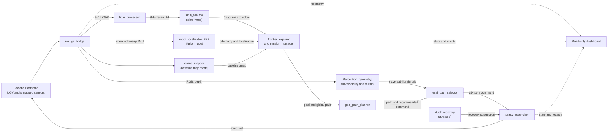

# DRISTHI — SIH26126 Autonomous UGV

DRISTHI is a ROS 2 project for an unmanned ground vehicle (UGV) intended to
explore outdoor terrain where GPS may be unavailable. The repository brings
together simulated sensing, localization and mapping, terrain assessment,
frontier-based exploration, planning, and safety-supervised motion.

The project is developed for **Smart India Hackathon problem statement
SIH26126**. The current repository is a simulation-focused research and
engineering baseline, not a claim of field deployment or fully validated
autonomy.

> **Validation note:** Features are described at their actual level of
> implementation. Build or unit-test results do not by themselves establish
> complete ROS integration or reliable end-to-end behavior.

## Contents

- [Problem and objectives](#problem-and-objectives)
- [Engineering approach and intended differentiators](#engineering-approach-and-intended-differentiators)
- [Feature status](#feature-status)
- [System architecture](#system-architecture)
- [Autonomy workflow](#autonomy-workflow)
- [Safety and TF design](#safety-and-tf-design)
- [Technology stack](#technology-stack)
- [Repository structure](#repository-structure)
- [Prerequisites and installation](#prerequisites-and-installation)
- [Build and launch](#build-and-launch)
- [Testing and validation](#testing-and-validation)
- [Limitations and roadmap](#limitations-and-roadmap)
- [Troubleshooting](#troubleshooting)
- [Contributing](#contributing)
- [Contact and collaboration](#contact-and-collaboration)
- [Acknowledgements and references](#acknowledgements-and-references)

## Problem and objectives

Outdoor mobile robots must estimate where they are, build a usable representation
of unfamiliar surroundings, and choose traversable routes despite incomplete
maps and changing sensor quality. In a GPS-denied setting, these tasks depend on
onboard sensing and consistent coordinate frames rather than an external
position fix.

DRISTHI explores a modular ROS 2 approach to those challenges:

- Convert simulated 3-D LiDAR returns into a 2-D scan usable by `slam_toolbox`.
- Combine local odometry and inertial observations, with an RGB-D odometry
  baseline available in the localization configuration.
- Build or consume an occupancy map and select reachable exploration frontiers.
- Estimate terrain traversability and expose obstacle and localization signals
  to planning and safety components.
- Keep motion commands under a separate safety supervisor rather than allowing
  exploration or planning nodes to drive the simulated robot directly.

The project currently exercises these ideas in Gazebo. It does not integrate
GPS, RTK, or a physical vehicle sensor suite.

## Engineering approach and intended differentiators

The engineering focus is on making the autonomy pipeline inspectable and
composable, rather than presenting a single planner as a complete field-ready
system:

1. **GPS-denied localization path:** 2-D LiDAR SLAM provides the `map → odom`
   transform when enabled; `robot_localization` is configured for local
   `odom → base_link` estimation. The reference launch enables both.
2. **Terrain and obstacle signals:** Separate perception, terrain geometry,
   traversability, LiDAR obstacle, and cost-map components expose signals that
   can inform exploration and local planning. Their presence and launch wiring
   are not proof that the complete data path has been validated at runtime.
3. **Separated command authority:** Global and local planning publish
   recommendations. The safety supervisor arbitrates the final `/cmd_vel`
   output; stuck recovery publishes a suggestion rather than bypassing it.
4. **Mission and decision records:** Mission-management, mission-profile, and
   event-logging components are included to make mission state and selected
   actions easier to inspect. Full ROS-level mission integration and
   user-visible explanations remain areas for validation.

These are intended differentiators and design choices. No comparative
performance, field reliability, or numerical advantage is claimed.

## Feature status

Status labels describe the evidence available in this checkout:

- **Implemented** — component logic is present in source.
- **Integrated** — component is wired into a package or launch description.
- **Tested** — a test or validation record exists; this does not imply runtime
  validation.
- **Runtime-observed** — a dated record documents a particular runtime
  observation; it is not a general performance guarantee.
- **Partial** — only part of the intended behavior or integration is complete.
- **Planned** — work is not yet available as an operational feature.

| Capability | Status in this repository |
|---|---|
| ROS 2 and Gazebo simulation bringup | **Integrated.** `full_stack.launch.py` wires the simulator, bridges, and autonomy packages. |
| LiDAR scan conversion and health reporting | **Implemented; integrated.** `lidar_processor` publishes `/lidar/scan_2d` and `/sensor_health/lidar`. Sensor rates and the SLAM/TF pipeline have prior runtime records. |
| LiDAR SLAM and local state estimation | **Integrated; tested.** `slam_toolbox` and the EKF are launch-selectable. The EKF configuration uses wheel odometry, IMU, and RGB-D odometry inputs; contribution and accuracy of the RGB-D input have not been established by the available runtime evidence. |
| Occupancy mapping and frontier selection | **Implemented; tested.** Frontier and mapping tests exist. Earlier runtime notes record map/frontier activity; the later verification run did not establish sustained goal-reaching. |
| Terrain assessment and temporal terrain data | **Implemented in components; partially integrated.** Geometry, classification, traversability, terrain-memory, and cost-map components are present. Their full end-to-end effect on navigation has not been runtime-verified. |
| Mission management and profiles | **Implemented; partial integration.** Exploration is the configured full-stack mission. Waypoint, coverage, search, and return-home profile logic should not be interpreted as demonstrated end-to-end missions. |
| Local obstacle/risk handling | **Implemented; tested in focused tests; partial runtime validation.** Dynamic-obstacle detection and evasive response have not been demonstrated in the simulator. |
| Safety command arbitration | **Integrated by design.** `safety_supervisor` is the `/cmd_vel` publisher; planner and recovery commands are advisory topics. Do not interpret this architecture as a demonstrated safety guarantee. |
| Dashboard and explainability events | **Integrated in launch; partial verification.** The dashboard is designed as read-only. Process startup has been recorded, but browser-visible rendering and HTTP behavior were not confirmed in the latest verification notes. |

## System architecture

The diagram shows the main data flow described by the package and launch
sources. SLAM and the baseline online mapper are alternative owners of the
navigation occupancy map; the `slam:=true fusion:=true` launch is the documented
reference configuration.



### Packages and responsibilities

| Package | Responsibility |
|---|---|
| `sih26126_bringup` | Gazebo/ROS launch files and bridge configuration |
| `sih26126_sim` | UGV SDF models, simulation worlds, and model resources |
| `sih26126_msgs` | Project-specific ROS message definitions |
| `sih26126_sensor_contract` | LiDAR processing, sensor health, scan relay, obstacle extraction/tracking |
| `sih26126_localization` | Sensor adapters, SLAM activation/pose adapters, EKF support, and TF publishers |
| `sih26126_perception` | RGB camera perception baseline |
| `sih26126_geometry` | Terrain geometry and classification |
| `sih26126_traversability` | Traversability scoring and terrain-memory components |
| `sih26126_autonomy` | Mapping, frontier exploration, mission management, profiles, and event logging |
| `sih26126_planner` | Global path generation, local path selection, and cost-map fusion |
| `sih26126_safety` | Safety supervisor, degraded-autonomy state, and stuck-recovery suggestion |
| `sih26126_dashboard` | Read-only autonomy dashboard and optional Gazebo GUI streaming support |

### Important ROS topics

Topic availability depends on the launch mode and node health.

| Topic | Role |
|---|---|
| `/clock` | Gazebo simulation time bridged into ROS |
| `/lidar/points` | Bridged 3-D LiDAR point cloud |
| `/lidar/scan_2d` | 2-D scan from `lidar_processor` |
| `/sensor_health/lidar` | LiDAR health status |
| `/imu` | Simulated IMU |
| `/model/sih_ugv/odometry` | Simulated wheel/model odometry |
| `/depth_camera/points`, `/camera` | Simulated depth and RGB observations |
| `/map` | Occupancy map from the active mapping mode |
| `/localization/pose`, `/odometry/filtered` | Navigation pose and EKF odometry |
| `/exploration/goal`, `/planner/path` | Selected exploration goal and planned path |
| `/planner/local_recommended_cmd_vel` | Local planner's advisory command |
| `/recovery/cmd_vel_suggestion` | Recovery node's advisory command |
| `/safety/state`, `/safety/reason` | Safety supervisor state and explanation |
| `/cmd_vel` | Final motion command published by `safety_supervisor` |
| `/autonomy/mode` | Degraded-autonomy mode |

## Autonomy workflow

1. Gazebo publishes simulation time and simulated sensor/odometry data through
   `ros_gz_bridge`.
2. The LiDAR processor converts the 3-D point cloud to `/lidar/scan_2d`. When
   SLAM is enabled, `slam_toolbox` consumes the scan and publishes the map and
   `map → odom` transform.
3. With sensor fusion enabled, adapters prepare odometry and IMU input for the
   EKF. The launch also starts an RGB-D odometry baseline; the available
   verification does not establish how much this input contributes to
   localization performance.
4. The mapper and frontier explorer use map and pose information to identify
   candidate exploration goals. The mission manager supervises mission state.
5. The global planner and local path selector produce a path and advisory
   command using available terrain, obstacle, and localization signals.
6. The safety supervisor evaluates the advisory command and publishes the final
   `/cmd_vel`. Recovery suggestions remain advisory.

The configured showcase mission is exploration. Other mission-profile patterns
exist in the code, but their complete execution through planning, safety, and
simulation is not verified. The `dynamic_obstacle` scenario is experimental.

## Safety and TF design

The command path is intentionally separated:

```text
goal_path_planner
  → /planner/recommended_cmd_vel
local_path_selector
  → /planner/local_recommended_cmd_vel
stuck_recovery
  → /recovery/cmd_vel_suggestion
safety_supervisor
  → /cmd_vel
```

Only `safety_supervisor` is intended to publish `/cmd_vel`. The source launch
conditions select one authority for each transform in the reference modes:

| Transform | Authority in the reference launch |
|---|---|
| `map → odom` | `slam_toolbox` when `slam:=true` |
| `odom → base_link` | EKF when `slam:=true fusion:=true` |
| `odom → base_link` | `odom_tf_publisher` when `slam:=true fusion:=false` |
| `odom → base_link` | Gazebo TF bridge in baseline mode (`slam:=false`) |
| Sensor-frame transforms | Static publishers enabled by the corresponding SLAM/fusion launch options |

Confirm live publishers and TF in the chosen launch configuration before a
demonstration. Unit tests and mutually exclusive launch conditions are not a
formal safety case; no field safety guarantee is claimed.

## Technology stack

| Area | Technology confirmed by repository |
|---|---|
| Operating system | Ubuntu 24.04 or compatible environment (repository running guide) |
| Robotics middleware | ROS 2 Jazzy |
| Simulation | Gazebo Sim Harmonic and SDF models/worlds |
| Languages | Python for ROS nodes and tests; CMake/C++ message package infrastructure |
| ROS build/test tools | `colcon`, `rosdep`, `ament` |
| Localization and mapping | `slam_toolbox`, `robot_localization` |
| Simulation bridge | `ros_gz_bridge` |
| Python libraries | `rclpy`, NumPy, and OpenCV are declared or used in package sources |
| Simulated sensors | 3-D LiDAR, RGB and depth cameras, IMU, and model/wheel odometry |

Exact patch versions are managed by the ROS distribution and local environment;
the repository does not pin a complete OS or dependency lockfile.

## Repository structure

```text
.
├── README.md
├── docs/                 # Architecture, running, validation, and limitations notes
├── src/
│   ├── sih26126_autonomy/
│   ├── sih26126_bringup/
│   ├── sih26126_dashboard/
│   ├── sih26126_geometry/
│   ├── sih26126_localization/
│   ├── sih26126_msgs/
│   ├── sih26126_perception/
│   ├── sih26126_planner/
│   ├── sih26126_safety/
│   ├── sih26126_sensor_contract/
│   ├── sih26126_sim/
│   └── sih26126_traversability/
├── build/                # Generated by colcon; do not commit
├── install/              # Generated by colcon; do not commit
└── log/                  # Generated by colcon; do not commit
```

`build/`, `install/`, and `log/` are generated locally and excluded by
`.gitignore`.

## Prerequisites and installation

Use Ubuntu 24.04 or a compatible ROS 2 Jazzy environment. Gazebo Harmonic,
`colcon`, and `rosdep` are required for the documented simulation workflow.
On WSL or a machine without a working graphics stack, use headless mode.

```bash
git clone https://github.com/bhargavshantharaju/sih26126_ws.git
cd sih26126_ws
source /opt/ros/jazzy/setup.bash
rosdep install --from-paths src --ignore-src -r -y
```

If the repository is already checked out, run the commands from its workspace
root instead of cloning it again.

## Build and launch

### Build the workspace

```bash
source /opt/ros/jazzy/setup.bash
colcon build --symlink-install
source install/setup.bash
```

### Launch the integrated showcase

```bash
source /opt/ros/jazzy/setup.bash
source install/setup.bash
ros2 launch sih26126_bringup full_stack.launch.py \
  slam:=true \
  fusion:=true \
  gui:=false \
  start_dashboard:=true \
  scenario:=showcase
```

The dashboard reports its URL at startup; its default port is `8080`.

Common launch arguments declared in `full_stack.launch.py`:

| Argument | Default | Purpose |
|---|---:|---|
| `slam` | `false` | Enable `slam_toolbox` |
| `fusion` | `false` | Enable EKF sensor fusion |
| `gui` | `false` | Start the Gazebo GUI instead of server-only mode |
| `start_dashboard` | `true` | Start the read-only dashboard |
| `dashboard_port` | `8080` | Preferred dashboard port |
| `scenario` | `showcase` | `showcase` or experimental `dynamic_obstacle` |
| `world` | Packaged showcase world | Override with an absolute Gazebo world SDF path |
| `exploration_radius_m` | `1000.0` | Frontier exploration radius from the captured home pose |
| `minimum_completed_frontiers` | `3` | Mission completion threshold |
| `minimum_explored_area_m2` | `24.0` | Mission completion threshold |
| `mission_timeout_sec` | `1800.0` | Mission failure cutoff; not the exploration completion condition |

The reference SLAM/fusion configuration is `slam:=true fusion:=true`. The
`dynamic_obstacle` scenario is experimental and is not a validated demo mode.

### Check live ROS data

In a second terminal, source both environments and inspect the pipeline:

```bash
source /opt/ros/jazzy/setup.bash
source install/setup.bash
ros2 topic hz /lidar/points
ros2 topic hz /lidar/scan_2d
ros2 topic hz /odometry/filtered
ros2 run tf2_ros tf2_echo map odom
ros2 topic info -v /cmd_vel
```

## Testing and validation

Run the repository test suite from the workspace root after building:

```bash
source /opt/ros/jazzy/setup.bash
source install/setup.bash
colcon test
colcon test-result --all --verbose
```

The autonomy package also has a recorded direct `pytest` invocation:

```bash
python3 -m pytest src/sih26126_autonomy/test/ -v --tb=short
```

### Existing validation evidence

The following are **dated results recorded in repository-session verification
notes**, not results rerun while preparing this documentation:

- A 2026-10-16 workspace record reports 12 packages built successfully.
- A 2026-10-16 `colcon test` record reports 329 workspace tests, 0 failures,
  0 errors, and 5 skipped.
- A separate 2026-10-16 direct autonomy test record reports 75 passing tests.
  These counts are reported separately; no fresh aggregate run was performed
  for this README update.
- Earlier validation notes record live sensor/TF observations. A later
  2026-10-16 runtime review was shorter than 30 seconds and did not confirm
  sustained goal-reaching or forward locomotion.

Unit tests validate individual logic and selected regressions. They do not
establish full launch integration, reliable obstacle avoidance, field
performance, or deployment readiness. Dynamic-obstacle response, physical
stuck recovery, and browser-visible dashboard rendering remain unverified.

## Limitations and roadmap

- **Simulation-focused:** Real vehicle integration, calibration, and field
  validation are not established.
- **Dynamic obstacles:** The scenario and perception/planning code are present,
  but a moving-obstacle encounter and evasive response have not been
  demonstrated.
- **Recovery:** State-machine tests exist; a controlled Gazebo run that
  physically gets stuck and recovers has not been validated.
- **Mission profiles:** Exploration is the configured mission. Other profiles
  need end-to-end ROS and simulator validation before being described as
  operational.
- **Terrain/cost fusion:** Supporting components are present; their complete
  effect on route selection and motion needs runtime verification.
- **Dashboard:** Process-level checks do not confirm browser rendering,
  streaming, or HTTP behavior.
- **Localization:** The RGB-D odometry baseline and its contribution to the EKF
  require quality and runtime validation. The system has no GPS/RTK input.
- **Global risk planning:** Risk and obstacle signals are not demonstrated as
  a complete global route-optimization capability.

Priorities for future work are sustained simulation tests, ROS-level mission
integration tests, validated dynamic-obstacle and recovery scenarios,
localization-quality evaluation, and eventual hardware testing.

## Troubleshooting

### ROS commands cannot find packages

Source ROS and the workspace overlay in each terminal:

```bash
source /opt/ros/jazzy/setup.bash
source install/setup.bash
```

### Simulation time or sensors do not advance

Check that Gazebo and the bridge are running, then inspect `/clock` and the
sensor topics:

```bash
ros2 topic hz /clock
ros2 topic hz /lidar/points
ros2 node list | grep bridge
```

### The map remains at its initial size

Confirm `slam:=true`, check `/lidar/scan_2d` and the TF chain, and review
`src/sih26126_localization/config/slam_params.yaml`. The current configuration
sets `minimum_travel_distance` and `minimum_travel_heading` to `0.0` so startup
scans can be accepted without robot movement.

### The robot does not move or the safety state is stopped

Inspect the state and reason topics before changing parameters:

```bash
ros2 topic echo /safety/state --once
ros2 topic echo /safety/reason --once
ros2 topic echo /planner/navigation_state --once
ros2 topic echo /localization/confidence --once
ros2 topic info -v /cmd_vel
```

Wait for mapping and localization startup, and verify that the safety
supervisor—not a planner node—is the `/cmd_vel` publisher.

### Gazebo GUI does not render in WSL

Use the documented headless launch setting `gui:=false`. GUI rendering depends
on the host display and graphics environment.

## Contributing

Bug reports, technical questions, and proposed improvements are welcome through
[GitHub Issues](https://github.com/bhargavshantharaju/sih26126_ws/issues). For
code contributions, open a focused pull request that explains the motivation,
affected ROS packages, validation performed, and any behavior not tested.
Please avoid committing generated `build/`, `install/`, `log/`, cache, or
simulation-recording files.

## Contact and collaboration

Repository: <https://github.com/bhargavshantharaju/sih26126_ws>

For questions, technical discussion, collaboration, or a project demonstration,
please contact the project through GitHub Issues.

- LinkedIn: [Add LinkedIn profile URL]

## Acknowledgements and references

DRISTHI builds on the ROS 2 and Gazebo ecosystem and the following packages
declared or used by this project:

- [ROS 2 Jazzy documentation](https://docs.ros.org/en/jazzy/)
- [Gazebo Harmonic documentation](https://gazebosim.org/docs/harmonic/)
- [`slam_toolbox`](https://github.com/SteveMacenski/slam_toolbox)
- [`robot_localization`](https://github.com/cra-ros-pkg/robot_localization)
- [`ros_gz`](https://github.com/gazebosim/ros_gz)

The ROS package manifests declare Apache-2.0. Check the relevant package
metadata and license file before reusing an individual package.
